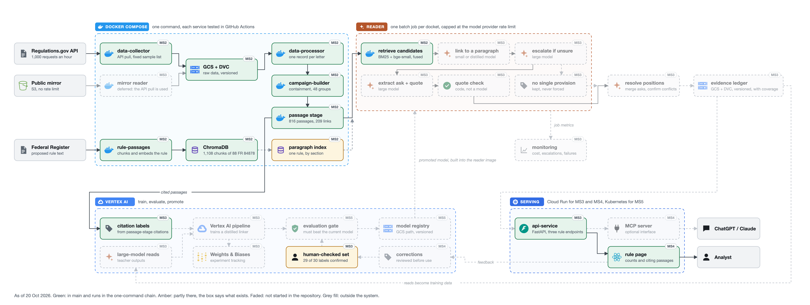
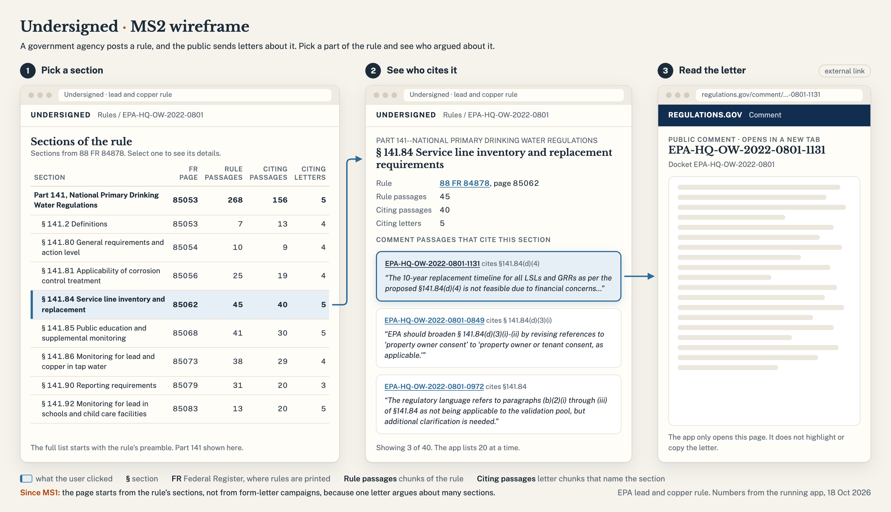

# Undersigned: Who Argued About Which Part of a Federal Rule

AC215 · Aidan Eichman, Aadil Jamari, Livia Jonnatan, Andrew Yuan, Rishi Jain

When a federal agency proposes a rule, anyone can send a comment, and some rules get hundreds of thousands. The agency has to answer every significant argument, but no one outside it can see who argued about which part of the rule. Undersigned reads a rule's whole comment record, sets aside copies of the same form letter, cuts the letters into passages and links each passage to the section of the rule it argues about. An analyst opens a section and sees who commented on it and what they asked for. It never labels a comment or a person as fake.

The project started as campaign detection in MS1. Testing that plan on full dockets moved the hard part from grouping to linking: see [Changes since Milestone 1](#changes-since-milestone-1).

MS2 docket: EPA-HQ-OW-2022-0801 (Lead and Copper Rule Improvements, 88 FR 84878). Development docket from MS1: EPA-HQ-OW-2018-0149 (2019 "waters of the United States" rule, 518,473 comments). Transfer docket: EPA-HQ-OAR-2017-0355 (Clean Power Plan repeal).

Milestone 1 proposal: `main.tex` / `milestone1.tex`. MS1 application mock: `docs/mock.png`. MS2 wireframe: `docs/wireframe.png`.

## Milestone 3: the linker

New since MS2, all on the `milestone3` branch: a trained model that links a comment passage to the section of the rule it argues about, its training on Vertex AI tracked in W&B, a Vertex AI pipeline that only promotes a model that beats what is served, the model behind a new `POST /link` endpoint, and the API on Cloud Run with request logging. The MS2 submission (`milestone2` branch) is unchanged.

### The problem it solves

The MS2 rule page counts only passages that cite a section number, and 3.7% of substantive comments do. Linking the rest is the core of the project. The commenters who do cite give free training labels: hide the citation, and the model has to recover the section from what the passage argues. The frozen test set and eight methods' answers on it come from the 11 Oct linking test and were not changed for this milestone (`data/linking/`, in DVC).

The model is a contrastive fine-tune of `BAAI/bge-small-en-v1.5`, the encoder rule-passages already serves. No new service and no new model size: the tuned copy replaces the untuned one.

| Choice | Why |
|---|---|
| Fine-tune the served encoder, not add a reranker | The 11 Oct feature reranker needs BM25, embeddings and a nearest-neighbour lookup stitched together. One encoder is simpler to serve, and it ties the reranker |
| Hard negatives from the current model, mined again each epoch | The wrong sections the model ranks highest are the ones worth learning from |
| Same-section passages masked out of the loss | Two passages citing one section are not negatives of each other. Leaving them out of batches instead broke the learning-rate schedule (below) |
| Cached gradients | A batch of 32 passages with 3 negatives each is 128 texts; caching gradients keeps memory at one chunk, so the same batch trains on a 16 GB laptop and on Vertex |
| Served through ONNX | The API image has no PyTorch. The exported model matches the trained one to a cosine gap of 1.2e-7 on 64 texts |

### Results on the frozen test set

All numbers from `python src/main.py report` in `linker-train/`, on passages no training comment shares text with. Intervals resample comments. Full tables: [`docs/evidence/linker-train/report.md`](docs/evidence/linker-train/report.md). Plain-language summary: [`docs/linker-results.md`](docs/linker-results.md).

| Method | Top-1, 490 cited passages | Top-1, 232 passages the LLMs answered | $ per 1,000 passages |
|---|---|---|---|
| bge-small, untuned (served in MS2) | 43.5% | 44.8% | 0 |
| Hybrid search (BM25 + bge-small) | 52.6% (47.6 to 57.8) | 53.4% | 0 |
| Feature reranker C (11 Oct) | 65.9% (60.9 to 70.5) | 68.1% | 0 |
| Tuned bge-small (`in`, served until 29 Oct) | 64.9% (59.5 to 70.2) | 67.2% (60.4 to 73.5) | 0 |
| Tuned with preamble pairs (`in-pre`, served) | 65.5% (60.8 to 70.2) | 68.5% (62.2 to 74.7) | 0 |
| **`in-pre` + preamble and letter scores** | **66.7% (62.0 to 71.2)** | **69.8% (63.1 to 75.8)** | **0** |
| Haiku | | 69.0% | 1.29 |
| Sonnet | | 75.4% | 19.58 |

| Paired difference in top-1, same passages | Points (95% interval) |
|---|---|
| Tuned minus untuned | +21.4 (+16.3 to +26.5) |
| Tuned minus hybrid search | +12.2 (+7.1 to +17.1) |
| Tuned minus feature reranker C | −1.0 (−5.3 to +3.2) |
| Tuned minus Haiku | −1.7 (−9.1 to +5.6) |
| Tuned minus Sonnet | −8.2 (−15.6 to −0.9) |
| `in-pre` + scores minus Haiku | +0.9 (−5.9 to +7.6) |
| `in-pre` + scores minus Sonnet | −5.6 (−11.9 to +0.5) |

**Preamble pairs (29 Oct).** A proposed rule opens with the agency's discussion of each section, in the language commenters argue in. Each preamble paragraph under a heading that names a section becomes a training pair for that section, with section numbers masked: 1,258 for ED, 564 HHS, 407 PHMSA, 200 MSHA, 97 lead and copper, 17 Clean Power Plan, and no human labels (`src/linker/extras.py`). At ranking time two more scores are added to the encoder's: the best preamble paragraph for each section, and whether the letter cites the section elsewhere. Their weights are chosen on half the test comments and scored on the other half, both ways (`src/linker/combine.py`). On rules the model has letters for, this closes about a third of the gap to Sonnet; the difference is no longer clear at 95%, but Sonnet's estimate is still 5.6 points higher. The larger gain is on rules with no letters, below.

On the 40 uncited passages one of us labelled by hand on 11 Oct, the tuned model gets 35 right (87.5%, 75.0 to 97.5) and `in-pre` with the added scores 36 (90.0%, 80.0 to 97.5), against 47.5% untuned, 57.5% for hybrid search, 75.0% for reranker C and 87.5% for Sonnet. It was trained only on cited passages, so this is the property the plan rests on. One labeller and n=40, so it is a first reading.

**Cascade.** The tuned model answers every passage and Sonnet answers the ones where the first two sections are closest. The share sent to Sonnet is chosen on half the comments and scored on the other half, both ways. With `in` first: 71.1% top-1 at $2.09 per 1,000 passages. With `in-pre` and the added scores first: **70.7% top-1 at $1.33 per 1,000 passages**, 94% of Sonnet's accuracy at 7% of its cost. The two halves chose different shares (15% and 0%), so the cutoff is not settled; the API flags the least sure 20%. For the seven test dockets' 721,203 passages that is about $960 instead of $14,121.

### Where it fails

| Case | Result |
|---|---|
| Small dockets | `in-pre` top-1 by docket: PHMSA 76%, ED 73%, HHS 72%, MSHA 60%, lead and copper 52.5%, Clean Power Plan 47%. The last three have the fewest training passages and the shortest preambles |
| A rule it has never seen | Trained without any ED passages, `in` got 50.0% (39.6 to 59.4) on ED, below hybrid search (57%). Trained the same way but with ED's preamble pairs, and still no ED letters, it gets **67.0% (55.2 to 77.5)**: +17 points (+6.9 to +26.4) and above hybrid search by 10 (0 to +20). Evidence in `docs/evidence/linker-train/lodo-pre-ED/`. A new rule's preamble ships with the rule, so this needs no labels at all. The other five held-out dockets are still to run |
| Label noise | About 17% of citation labels cannot be recovered from the passage (11 Oct failure reading), so about 83% is the ceiling for any method scored this way |

**A bug the training curves caught.** The first run kept two passages citing the same section out of one batch. ED has 387 training passages on § 106.44, so an epoch became 387 mostly tiny batches instead of 131. The learning-rate schedule assumed 131, reached zero halfway through epoch 2, and epochs 3 and 4 changed nothing: validation read 73.9% three times. The fix masks same-section passages in the loss and keeps full batches. The buggy run is kept as `in-v1` (64.3%) for comparison.

### Reproduce training

```bash
cd linker-train
uv sync
uv run wandb login                                                # once
uv run python src/main.py baseline                                # untuned encoder, 44.7% top-1
uv run python src/main.py train --mode in --out out/in            # about 45 min on an M2 Pro
uv run python src/main.py train --mode lodo --out out/lodo        # one model per held-out docket
uv run python src/main.py report --runs out/in --out out/report   # every table above
```

Settings are in `configs/bge-small.yaml`; any can be overridden with `--set key=value`. Runs are tracked in the W&B project `undersigned-linker` (loss, learning rate, validation accuracy per epoch, and a table of test predictions), and each run folder has its config, history, metrics and every prediction.

**On Vertex AI:** `vertex/submit.sh in` builds the image in Cloud Build (`vertex/build.sh`, tagged with the commit) and starts a custom job that reads `gs://ac215-undersigned-data/linking` and writes `gs://ac215-undersigned-data/linker-runs/<run>/`. The project's T4 quota is 0 until Google grants the request, so `GPU=none vertex/submit.sh in` runs on a CPU machine (`MACHINE`, default e2-standard-16; n1-highcpu-16 had no capacity in us-central1 on 28 Oct).

### The pipeline

`vertex/run_pipeline.sh` starts a Vertex AI pipeline (`vertex/pipeline.py`) with three steps, each the linker-train image:

1. **train** on every docket's training comments, tracked in W&B.
2. **evaluate**: the report above, against every saved method.
3. **gate and promote**: export to `gs://ac215-undersigned-data/serving/linker/` only if the run beats hybrid search (lower end of the paired difference above zero) and is no worse than the served model. A rejected run writes `promotion.json` saying why. Checked on `in-v1`: it beats hybrid search by 11.6 (6.8 to 16.2) but scores 64.3% against 64.9% served, so it is not promoted.

**First run, 28 to 29 Oct** (`undersigned-linker-20261028234305`, W&B run `zyqws7hu`, [evidence](docs/evidence/linker-train/vertex/)). All three steps succeeded in 5 hours on an e2-standard-16 with no GPU, 57 to 71 minutes an epoch against about 10 on the M2 Pro.

| | Laptop (MPS) | Vertex AI (CPU) |
|---|---|---|
| Validation top-1, epochs 0 to 4 | 48.8, 71.6, 72.9, 74.3, 74.3 | 48.8, 71.6, 72.9, 74.3, 74.3 |
| Test top-1 | 64.9% (59.5 to 70.2) | 64.9% (59.5 to 70.2) |
| Test passages given the same rank | | 490 of 490 |

The two runs agree on every test passage, so the seed and the data version reproduce the model on different hardware.

The gate rejected it, wrongly. The run gets 318 of 490 right, 0.64898, and the served model's `linker.json` stores the same score rounded to 0.649, so "at least as good" failed on rounding. The check now compares at the stored precision (`no_worse` in `src/linker/promote.py`, with tests), and the same decision rerun on this run promotes it. The model it would have promoted is the one already served, so the API did not change.

The same gate is the retraining trigger MS5 needs: a new docket's citing letters come in, the pipeline trains, and the API only changes if the new model wins.

### The API: `POST /link`

```bash
curl -s -X POST localhost:8000/link -H 'Content-Type: application/json' -d '{
  "text": "Requiring systems to replace every lead service line within ten years is not feasible for small utilities with limited staff.",
  "docket_id": "EPA-HQ-OW-2022-0801", "k": 3}'
```

| Field | Meaning |
|---|---|
| `text` (required) | One comment passage. HTML is cleaned as in `/retrieve`; the first 300 words are read, as in training |
| `docket_id` (required) | The rule to link against. A docket with no regulatory sections indexed is a 404 naming the ones that have them |
| `k` | Sections to return, default 5 |

The response ranks the rule's regulatory sections (`section_ref` such as `PART 141/§ 141.84`, with `heading`, `citation`, `page`, `score`) and gives each one's best-matching rule text as `evidence`, so a reader can check the link. `margin` is the gap between the first two scores; `needs_reader` is true when it is under the cutoff stored with the model, the least sure 20% of the test set, and a batch job sends those passages to the reader model. `model` names the run, commit and test accuracy being served. Without a model (`LINKER_MODEL_DIR` unset) `/link` answers 503, and `/health` reports `"linker": null`.

Checked end to end: the 80 lead and copper test passages sent to the running API score 57.5% top-1 and 87.5% top-5 (55.0% and 88.8% in evaluation, which used slightly different rule windows), flag 21% for the reader, at 20 ms median and 35 ms at the 90th percentile on a laptop (`scripts/link_check.py`, [evidence](docs/evidence/linker-train/link-check-local.json)). Tests: `api-service/tests/test_link.py` (7 tests, fake embedder, offline).

### Deployment and monitoring

`api-service/cloudrun/deploy.sh` builds the API image in Cloud Build with the rule index and the promoted linker inside it (from `gs://ac215-undersigned-data/serving/`), so Cloud Run needs no ChromaDB server, and deploys it as `undersigned-api` (2 CPU, 4 GiB, scales to zero, at most 2 instances). The service is private: callers need an identity token from an account with the `run.invoker` role.

```bash
URL=$(gcloud run services describe undersigned-api --region us-central1 --format 'value(status.url)')
curl -s -H "Authorization: Bearer $(gcloud auth print-identity-token)" "$URL/health"
```

Every request is logged as one JSON line (`route`, `status`, `latency_ms`, `severity`), never its body, so Cloud Logging can filter and chart by field:

```bash
gcloud logging read 'resource.type="cloud_run_revision" AND resource.labels.service_name="undersigned-api" AND jsonPayload.route="/link"' --limit 20
```

`GET /stats` gives each route's request count, server errors and p50, p90 and p99 latency for the instance.

**Deployed** at `https://undersigned-api-658318685216.us-central1.run.app` (private; 403 without a token). The first deploy ran out of memory at 2 GiB while loading the second model (2,323 MiB used), so it has 4 GiB. Evidence in [`docs/evidence/cloud-run/`](docs/evidence/cloud-run/):

- [`link-curl.txt`](docs/evidence/cloud-run/link-curl.txt): the example above against Cloud Run. It ranks § 141.84 (service line inventory and replacement) first and § 141.81 (treatment steps by system size) a hair behind, 0.5264 against 0.5263, and sets `needs_reader`: the passage argues about both.
- [`link-check.json`](docs/evidence/cloud-run/link-check.json): the 80 lead and copper test passages against Cloud Run, 57.5% top-1 and 87.5% top-5, the same as the local run, 166 ms median and 294 ms at the 90th percentile from a laptop on home wifi.
- [`link-check-in-pre.json`](docs/evidence/cloud-run/link-check-in-pre.json): the same 80 passages after `in-pre` was promoted and redeployed on 29 Oct (revision `undersigned-api-00003-jc5`): 57.5% top-1, 88.8% top-5, 26% flagged for the reader, 172 ms median.

## Architecture



Green runs in main from one command; amber is partly there; faded is not started. The second page, the
technical architecture ([`solution.png`](docs/architecture/solution.png)), shows who uses the system, where each container runs,
its ports and mounts, and what persists, with a table of what each container is given at build and at
start. Both pages: [PDF](docs/architecture/undersigned-architecture.pdf) and
[HTML](docs/architecture/undersigned-architecture.html).

## Repository layout

```
data-collector/    Pull comments and attachments from Regulations.gov and FCC ECFS
data-processor/    One canonical record per letter; PDF text, OCR, signer hashing
campaign-builder/  Group copies of the same form letter; B-cubed scorer
passage-stage/     Cut letters into passages and link the rule sections they cite
rule-passages/     Chunk Federal Register rule text into ChromaDB
api-service/       FastAPI service the frontend calls
frontend/          React rule page served by nginx; calls the API through /api
docs/              Setup, data and evidence; architecture diagrams; MS1 mock-up, MS2 wireframe and figures
docker-compose.yml One service per container plus ChromaDB
.dvc/              DVC config; remote is the GCS bucket
schema.md          Every file and field the pipeline reads and writes, raw through labels, and why
docs/setup.md      Running it from a fresh clone: the demo, the full data, every .env setting, troubleshooting
docs/decisions.md  Why each part is built the way it is, and what it was picked over
```

Each Python container (data-collector, data-processor, campaign-builder, passage-stage, rule-passages, api-service) has its own `Dockerfile`, `pyproject.toml` and `uv.lock` (managed with `uv`), and `src/main.py`. The frontend is a Node build pinned by `package-lock.json`: its `Dockerfile` runs `npm ci` and `npm run build`, and nginx serves the result. The root `pyproject.toml` is the template new containers copy from.

## Prerequisites

- Docker and Docker Compose
- [uv](https://docs.astral.sh/uv/) (for local development outside containers)
- A `data.gov` API key, free at https://api.data.gov/signup/ (covers both Regulations.gov and FCC ECFS, 1,000 requests/hour per key)
- For the team data path only (`dvc pull`): access to the `ac215-undersigned` GCP project and its service-account key. The demo needs no GCP account or key

## Setup

The demo needs Docker and one free API key, nothing else:

1. Clone the repo:

   ```bash
   git clone https://github.com/aidaneichman/AC215_Undersigned.git
   cd AC215_Undersigned
   ```

2. Create your environment file and fill in the keys:

   ```bash
   cp .env.example .env
   ```

   Paste your data.gov key on `API_DATA_GOV_KEY`.

`.env.example` defaults to the 40-record demo sample, so the whole chain takes about a minute on a laptop once the images are built, and about 16 minutes on a small VM including the build. Full instructions, the team path with the versioned data (`dvc pull`), every `.env` setting and a troubleshooting list are in [`docs/setup.md`](docs/setup.md).

## Running the pipeline

One command builds every container, runs the batch stages in order and starts the serving stack:

```bash
docker compose up --build
```

Stage order is enforced in `docker-compose.yml` with `depends_on` conditions: `data-collector` → `data-processor` → `campaign-builder` → `passage-stage`, with `rule-passages` (which needs ChromaDB) in parallel and finished before `passage-stage` starts; `api-service` starts once both chains have completed, then `frontend`. A batch stage that exits non-zero stops everything behind it.

**A first run uses the fixed 40-record sample.** `.env.example` sets `DOCKET_IDS=EPA-HQ-OW-2022-0801` (Lead and Copper Rule Improvements) and `RECORD_IDS_FILE=/app/samples/ms2_ids.txt`, so the collector fetches exactly those 40 records and their attachments in about 40 API calls, and `rule-passages` indexes the proposal that docket's comments answered (88 FR 84878). The whole chain takes about a minute on a laptop once the images are built, and about 16 minutes on a small VM including the build. The sample is described in [`data-collector/samples/`](data-collector/samples/README.md).

To pull more, empty `RECORD_IDS_FILE`. Then `MAX_RECORDS=50` takes the first 50 records of the docket, and an empty `MAX_RECORDS` takes all of it. A whole docket can take hours: the development docket (EPA-HQ-OW-2018-0149) needs about 11 on one key. Use `SHARD` (for example `2/5`) to split a full pull across containers with their own keys. Anything already on disk is skipped, so reruns are quick, and a capped run does not stop a later uncapped one from finishing the index. A key that another job is using is rested for an hour by the collector, so give the pipeline its own key.

Once up:

- Frontend: http://localhost:3000
- API: http://localhost:8000 (`GET /health` returns `"status": "ok"` and how many rule passages it loaded; interactive docs at `/docs`)
- ChromaDB: http://localhost:9000

Stop everything with `docker compose down`.

To run a single stage, e.g. while developing it:

```bash
docker compose run --rm data-processor
```

Each container mounts its own `src/` and the shared `data/` directory, so code edits take effect without a rebuild.

## Data versions

Raw data lives in `data/raw/`, tracked with DVC and stored in `gs://ac215-undersigned-data/dvc`. `dvc pull` restores exactly the version that the `.dvc` pointers in a commit name. Derived files are rebuilt by the pipeline, not stored. Each stage writes a summary that records the version of what it read, so any output traces back to a raw snapshot.

| Container        | Reads                              | Writes                               | Data version |
| ---------------- | ---------------------------------- | ------------------------------------ | ------------ |
| data-collector   | Regulations.gov / ECFS APIs        | `data/raw/<docket>/`                 | `data/raw/EPA-HQ-OW-2018-0149.dvc`; 11,444 details, 4,009 attachment files, 1 failed (403 on a .jpg) |
| | | | `data/raw/EPA-HQ-OAR-2017-0355.dvc` (26,206 details, 9,699 attachment files, 0 failed) |
| | | | `data/raw/EPA-HQ-OW-2022-0801.dvc` (1,589 details, 482 attachment files, 0 failed) |
| data-processor   | `data/raw/<docket>/`               | `data/derived/letters/<docket>/`     | `processing_report.json` records the sha256 of the raw `.dvc` pointer it read, of the tokenizer, and of the plan |
| campaign-builder | `data/derived/letters/<docket>/`   | `data/derived/campaigns/<docket>/`   | `summary.json` records the sha256 of the letters file it grouped |
| passage-stage    | `data/derived/letters/`, `data/derived/campaigns/`, rule text | `data/derived/passages/<docket>/` | `summary.json` records the sha256 of the letters file and the rule documents it linked against |
| rule-passages    | `data/raw/federal_register/<docket>/` | ChromaDB collection `rule_passages` | `data/raw/federal_register.dvc`. Chunk ids are `<document_number>:<index>` and each chunk carries a hash of its text, so a rerun re-embeds only what changed |

The hand-check labels (30 passages, two readers) are in `docs/hand-check/` (#71). Both readers have confirmed 29; P132 has no agreed label (#85).

## Containers

<!-- Each owner fills in their section: what it does, inputs and outputs, how to run it alone, and a link to run logs. -->

### data-collector

Pulls one or more Regulations.gov dockets into `data/raw/<docket>/`. It is the only container that talks to the API; everything downstream reads the files it writes.

**Input** (`.env`): `API_DATA_GOV_KEY` (one or more keys, comma-separated; each allows 1,000 requests an hour), `DOCKET_IDS`, and one of three modes:

| mode | settings | what happens | time |
| --- | --- | --- | --- |
| demo (the `.env.example` default) | `RECORD_IDS_FILE=/app/samples/ms2_ids.txt` | fetches exactly the 40 listed records, no index | ~1 min |
| smoke test | `RECORD_IDS_FILE=` empty, `MAX_RECORDS=50` | the first 50 records of the docket | a few min |
| full pull | both empty | the whole docket | ~1 h per 1,000 records per key |

`SHARD=k/n` splits a full pull across n containers; `SKIP_ATTACHMENTS=1` skips file downloads.

**Output** (`data/raw/<docket>/`, schema in [`schema.md`](schema.md)): `comments_index.jsonl` (every comment's id and dates; absent in demo mode), `details/<id>.json` (each record exactly as the API returned it: text, submitter location, receive date, attachment list), `details_index.jsonl` (the few fields later stages need, one line per record), `attachments/<id>/<file>` and `attachments_manifest.jsonl` (the downloaded files and one line per file), `manifest.json` (counts and failures for the run).

**How it runs.** Three stages: list the docket 250 at a time (walking date windows past the API's 5,000-record cap), fetch each record, download each attachment. Files on disk are the state: a record or file that already exists is skipped, so a run can be stopped and restarted at any point, and a docket that was `dvc pull`ed goes straight to the processor. Keys rotate per request and are rested for an hour when their quota is nearly spent; if all keys are resting it sleeps and logs when it will resume. The index is marked complete only if its count equals the API's `totalElements`; otherwise the run fails rather than letting a short index through. A refused attachment (403/404) is logged and skipped.

**What it has produced**, all versioned in DVC (audits in [`docs/evidence/data-collector/`](docs/evidence/data-collector/)):

| docket | records | comments represented | attachment files |
| --- | --- | --- | --- |
| EPA-HQ-OW-2018-0149 (development) | 11,444 | 518,528 | 4,009 |
| EPA-HQ-OAR-2017-0355 (transfer) | 26,206 | 1,713,467 | 9,699 |
| EPA-HQ-OW-2022-0801 (demo) | 1,589 | 101,510 | 482 |

**Why the demo is a fixed list.** The first rows of any docket's index are early individual comments, so a 50-record smoke sample had nothing to group or link. The 40 ids in `data-collector/samples/ms2_ids.txt` are two personalized campaigns, ten organization letters that cite rule sections, and ten individuals; only ids are in git, text comes from the API at run time. See [`data-collector/samples/README.md`](data-collector/samples/README.md).

**Known limits.** The date filter the API uses for paging is read in Eastern time, which cost 538 records before it was found (#27); the count check now catches that class of error. Running the demo on a machine that holds the full lead-and-copper docket rewrites that folder's `manifest.json`; restore with `dvc checkout`, don't `dvc add`.

**Tests:** `cd data-collector && uv run pytest && uv run ruff check .` (18 tests, offline). `scripts/audit_attachments.py` checks a pull's completeness and finds scanned PDFs. `scripts/make_evidence_sample.py` builds the redacted evidence sample.

### data-processor

Converts raw comments and attachments into canonical letters using inline text, DOCX/PDF extraction, and OCR fallback. Preserves source identifiers, hashes signer metadata, and counts tokens with the bge-small tokenizer.

**Inputs:** `data/raw/<docket>/details/`, `attachments_manifest.jsonl`, and downloaded attachments.

**Outputs:** `data/derived/letters/<docket>/`, containing `letters.parquet`, `records.parquet`, `signers.parquet`, and `processing_report.json`.

**Run independently:** Restore the raw sample through DVC and configure `SIGNER_HASH_KEY` in `.env`, then run:

```bash
cd data-processor
uv sync --frozen
uv run ruff check .
uv run pytest -q
cd ..

docker compose build data-processor
docker compose run --rm --no-deps data-processor python src/main.py \
  --docket EPA-HQ-OW-2018-0149 \
  --data-root /app/data \
  --record-ids-file "" \
  --max-records 50 --strict
```

`--record-ids-file ""` turns off the demo list from `.env`, which would otherwise override `--max-records`.

The image carries the pinned tokenizer at `/app/models/bge/tokenizer.json` (downloaded and checksum-verified at build), so `docker compose up` runs this stage with no extra step. The tests do not need it: the one real-tokenizer check skips unless `BGE_TOKENIZER_TEST_PATH` points at a copy. To run the processor outside Docker, fetch a copy with `uv run python fetch_tokenizer.py --out ../data/models/bge/tokenizer.json` and pass that path as `--tokenizer`.

**Validation:** The real 50-record sample completed inside Docker with zero failures. Inspected letter text matched the source attachments. Real campaign-attachment extraction has not yet been validated.

**Run evidence:** [Data-processor validation](docs/evidence/data-processor/README.md)

### campaign-builder

Groups letters into campaigns. Three groupers, chosen with `GROUPING_METHOD`; `containment` is the default.

Under `docker compose up` the container runs `src/main.py`: for each docket in `DOCKET_IDS` it reads
`data/derived/letters/<docket>/letters.parquet`, groups the letters, and writes
`data/derived/campaigns/<docket>/assignments.parquet`, `campaigns.parquet`, `representatives.parquet` and
`summary.json` (counts, settings, B-cubed when EPA grouped any letters, and the sha256 of the letters file
read). It exits non-zero if the processor wrote no letters.

- **Containment** (`src/containment.py`, the default). The campaigns in our dockets are personalized: a
  template plus each sender's own words. Two letters from one campaign share most of the template, but the
  added words keep their Jaccard similarity low, so a letter is grouped by **containment**, the share of the
  smaller letter's five-word phrases found in the other. A group's template is the phrases more than half
  its members have (for two letters, the phrases both have). A first pass assigns each letter to the group
  whose template it contains most (at least 0.5, and neither over four times as long as the other, which
  keeps a long letter that reprints a campaign out of it). A second pass merges groups whose templates fit
  each other, one pair at a time, drops any member that does not fit the template of the other members,
  and regroups the letters left over. Every grouped letter contains at least half of what the rest of its
  campaign shares. A group is named after the member holding the most of its template.

  On the full lead and copper docket (1,553 letters, about 8 seconds on a laptop):

  | Grouper | Letters grouped | Groups | Largest groups |
  |---|---|---|---|
  | Exact match | 26 | 13 | 2, 2, 2 |
  | MinHash, Jaccard 0.8 | 53 | 22 | 6, 4, 3 |
  | Containment 0.5 | 459 | 48 | 160, 64, 48, 15, 14, 14 |

  On the 40-record sample, whose two campaigns are known, containment groups 18 of the 20 campaign letters,
  one group per campaign, with no other letter grouped (B-cubed F1 0.91; 1.00 at 0.4). The two it misses
  are short versions holding under half of what the other nine share. Exact match and MinHash at 0.8 find
  2. The full docket has no answer key, so it was checked other ways: the eight largest groups were read
  and each is one template; moving the threshold to 0.4 or 0.6 changes membership little (B-cubed F1 0.92
  and 0.90 against 0.5); and a run without the candidate shortcut gives identical groups.
  `scripts/evaluate_containment.py` prints all of these. Details in [`docs/evidence/campaign-builder/containment.md`](docs/evidence/campaign-builder/containment.md).
- **MinHash** (`src/minhash_grouping.py`). Jaccard similarity of five-word phrases with MinHash LSH. Right
  for near-identical copies; misses personalized ones (above).
- **Exact match** (`src/exact_match.py`). Two letters are one group when their text is identical after
  normalizing: HTML tags from the API removed, case and punctuation ignored, whitespace collapsed. A group
  is named after its earliest `letter_id`. A letter that matches nothing is an individual comment and gets
  no group (`campaign_id` null), and so does any letter under 20 words (`--min-words`): empty bodies and
  "See attached" stubs are identical to each other but are not a campaign (#40). Reads the schema's
  `letters.parquet`, writes `assignments.parquet`
  (`letter_id`, `campaign_id`, `method="exact"`, `similarity=1.0`).
- **B-cubed** (`src/bcubed.py`). Precision, recall and F1 of a grouping against EPA's, letter by letter:
  a letter's precision is the share of its predicted group that shares its EPA campaign, its recall the
  share of its EPA campaign that landed in its group, both averaged over letters. Letters EPA did not group
  (`epa_campaign_id` null) are left out of the score; a letter with no predicted group counts as a group
  of one. `score_frames` takes the two parquet tables directly.

```bash
cd campaign-builder && uv run pytest && uv run ruff check .        # 56 tests, offline
uv run python src/exact_match.py --letters <letters.parquet> --out assignments.parquet --score
```

`--score` prints B-cubed against `epa_campaign_id`. First run on the inline comment bodies of the
development docket: 3,967 letters, 62 in 17 exact-match groups, 3,905 individual. No F1 yet: EPA's
grouping only exists for letters inside campaign attachments, which the processor extracts. Logs and
the groups by size: [`docs/evidence/campaign-builder/`](docs/evidence/campaign-builder/README.md).

### passage-stage

Splits each distinct letter into passages and reads the rule sections it cites (U-26, #43). A campaign's
shared text is read once: the letter a group is named after is read whole, and every other member only
for the sentences not already read in its group, so each sender's own words are read and exact copies
are skipped.

- **Passages** (`src/passages.py`). The processor stores a letter as one line, so a passage is a run of
  whole sentences of about 120 words and never more than 250. A short last run joins the one before it.
  Sentences come from rule-passages' splitter, which does not split after "Sec." or "C.F.R.", so a
  citation is never cut away from its number.
- **Citations** (`src/citations.py`). The patterns measured in the linking test: a section sign
  (`§ 141.84(b)(2)`), the word section in any case (`SECTION 141.84`), a CFR reference (`40 CFR 141.85`),
  and a bare number with a paragraph (`141.84(a)`) only when that number is a section of the rule. On 80
  sampled citations, 6 (7.5%) were not about a section of the proposal. In a list, a later number counts
  only if it is in the same CFR part or is a section of the rule, so "40 CFR 141.80(c) to 0.010 mg/L" is
  one citation. A range (`§ 141.80–141.93`, `141.84 through 141.86`) links every section of the rule
  between its ends.
- **Resolution.** Each cited number is mapped to rule-passages' `section_ref` (for example
  `PART 141/§ 141.84`), read with rule-passages' own chunking from the rule text it collected. A number
  that is not a section of the rule keeps its `citation_raw` with `section_ref` null. A "section 2.4"
  style reference with a first number below 100 is read as the letter's own outline and left out. A
  section sign or "CFR" is always kept, so `§ 60.5740(a)` stays as an unresolved link.

Writes `data/derived/passages/<docket>/`: `passages.parquet` (one row per passage, with `text_masked`,
the text with every citation replaced, for scoring retrieval without handing it the answer),
`links.parquet` (one row per passage and cited section: `passage_id`, `letter_id`, `docket_id`,
`section_ref`, `citation_raw`, `source`) and `summary.json` (counts and the sha256 of the letters file
read). It exits non-zero if the letters, the groups or the rule text are missing. A rule with no
numbered sections, such as the Clean Power Plan repeal, still gets passages, with every link
unresolved, so the API still starts.

Only cited passages get links for now. Most passages cite nothing; linking those is the reader's job (MS3).

```bash
cd passage-stage && uv run pytest && uv run ruff check .        # 53 tests, offline
docker compose run --rm passage-stage                            # after campaign-builder and rule-passages
```

### rule-passages

Finds the rule sections a comment argues about. A comment goes in; ranked passages of the proposed rule come out, each with its Federal Register citation, page and section.

**Stages** (`docker compose run --rm rule-passages`, exits 0 when done):

1. **Collect.** Downloads every document filed under each docket in `RULE_DOCKETS` (default: the chain's `DOCKET_IDS`) from the Federal Register API (no key). Saved to `data/raw/federal_register/<docket>/`. Files already on disk are skipped.
2. **Chunk.** Strips the GPO markup, drops the table of contents, tracks headings and the printed page, and packs paragraphs into chunks of about 200 words (`CHUNK_MAX_WORDS`) that never cross a section. A chunk after the first opens with the last sentence or two of the one before (`CHUNK_OVERLAP_WORDS`). Only the document the comments answered is indexed (`COMMENTED_ON` in `config.py`, or `RULE_DOCUMENTS`), since comments cannot argue about text that did not exist yet. Summary, dates, addresses and general-information sections are flagged `procedural` and left out of retrieval by default: letters quote them without arguing about them.
3. **Embed and load.** `BAAI/bge-small-en-v1.5` through ONNX (no PyTorch), vectors stored in the ChromaDB collection `rule_passages` (cosine). Ids are `<document_number>:<index>` and each chunk carries a hash, so a rerun embeds only what changed and removes chunks that no longer belong.

**Look at the result:**

```bash
docker compose run --rm rule-passages python src/main.py outline                      # section references
docker compose run --rm rule-passages python src/main.py query --text "Requiring all lead service lines to be replaced within ten years is not achievable for small water systems"     # or --file; add --docket to limit it to one docket
# eval and sweep need a hand-mapped labels file, which is not in the repo
docker compose run --rm rule-passages python src/main.py eval --labels /app/data/labels/campaign_sections.jsonl
docker compose run --rm rule-passages python src/main.py sweep --labels /app/data/labels/campaign_sections.jsonl --sizes 120,250
docker compose run --rm rule-passages python src/main.py baseline                     # U-28 table, in data/derived/baseline/<docket>/
```

`eval` reports top-1 and top-3 accuracy for BM25 and for the embedding search on hand-mapped campaigns (format in `rule_passages/evaluate.py`; a campaign labeled "nothing specific" is left out of the score). Add `--include-procedural` to `eval` or `sweep` to also search the summary, addresses and similar sections, which measures what excluding them does. `sweep` re-indexes at each chunk size into its own collection and scores both. These are the numbers for the BM25-first, embeddings-second comparison in the MS1 proposal.

**For api-service** (the retrieval contract):

- Collection `rule_passages` at `CHROMA_HOST:CHROMA_PORT`. Document is the passage text. Metadata: `docket_id`, `document_number`, `doc_title`, `citation`, `url`, `publication_date`, `index`, `heading`, `section_ref`, `page`, `procedural`, `sha1`. Query with `where={"procedural": False}` (the retrievers do this by default).
- A query is cleaned of HTML, then embedded with the same model and the prefix in `rule_passages/embedding.py`. `DenseRetriever` and `BM25Retriever` in `rule_passages/retrieve.py` do both and return `Hit` objects. BM25 is built from `PassageStore.chunks()`, so it searches exactly what was indexed. `FusedRetriever` in the same file combines any retrievers into one list by reciprocal rank fusion (it uses ranks only, since BM25 and cosine scores are on different scales). The API's `"merged"` method and the evaluation both use it, so they fuse the same way.
- `Hit.to_dict()` is the JSON shape of a result (`retriever`, `rank`, `score`, `id`, `docket_id`, `document_number`, `citation`, `page`, `section_ref`, `heading`, `text`). The command line prints it and the API should return it as is, so a field added there reaches both.
- Both retrievers take an optional `docket_id`, so a request can be "this letter, from this docket". All configured dockets share the collection, and indexing one never deletes another's chunks. A docket that yields no chunks stops the stage with an error instead of emptying the index.
- `section_ref` is a path such as `III/D/1` (Roman numeral, letter, number) or `PART 328/§ 328.3`.

**Tests:** `cd rule-passages && uv run pytest` (96 tests, offline, no model download). `uv run ruff check .` is clean. Example run and logs: [`docs/evidence/rule-passages/`](docs/evidence/rule-passages/README.md).

### api-service

The HTTP service the frontend calls. It reads the ChromaDB collection `rule_passages` that rule-passages fills, and passage-stage's `links.parquet` and `passages.parquet` when they exist, and writes nothing. At startup it loads the embedding model and reads every passage and every link once, so a request only searches. It refuses to start if the collection is empty: run rule-passages first. A docket with no passage-stage files keeps its citation counts and citing-passage lists `null` (unknown, not zero). The retrieval code is not copied: the image gets `rule_passages` from `rule-passages/src` through a second build context (`additional_contexts` in `docker-compose.yml`), and the bge-small model is baked into the image. Compose mounts `./data/derived/passages` into the API read-only.

**Endpoints** (also browsable at http://localhost:8000/docs):

- `GET /health`: `{"status": "ok", "passages": 1108, "dockets": ["EPA-HQ-OW-2022-0801"]}` on the demo.
- `POST /retrieve`: a letter in, the rule passages it argues about out.

  | Field | Default | Meaning |
  |---|---|---|
  | `text` | required | The letter. HTML is cleaned the same way as in rule-passages. Blank text is rejected |
  | `k` | `3` | 1 to 50. Passages per retriever for `bm25`, `dense` and `both`; passages in total for `merged` |
  | `method` | `"both"` | `"bm25"`, `"dense"` (embeddings), `"both"` (two separate lists) or `"merged"` (one list, combined by rank) |
  | `docket_id` | none | Only search this docket's rule text. A docket the index does not hold returns no hits |

  The response is `{"hits": [...]}`, each hit in the shape `Hit.to_dict()` defines in rule-passages (`retriever`, `rank`, `score`, `id`, `docket_id`, `document_number`, `citation`, `page`, `section_ref`, `heading`, `text`). With `"both"`, BM25 hits come first, then embedding hits, as two lists that are not sorted together because their scores are on different scales. `"merged"` returns one list combined by reciprocal rank fusion: each retriever is searched 50 deep and a passage scores the sum of `1 / (60 + rank)` over the lists it appears in, so passages both retrievers rank well come first. Its hits have `retriever: "merged"`, and their `score` is that fused score, which cannot be compared with BM25 or cosine scores. Procedural sections are never returned. Invalid input gets a 422 naming the field.
- `GET /rules/{docket_id}/sections`: the sections of the rule that docket's comments answered, for the rule page. The response is `{"docket_id": ..., "unresolved_citations": ..., "sections": [...]}`, one entry per section in reading order. `unresolved_citations` is how many links have a null `section_ref` (a citation that is not a section of this rule), or `null` when there is no links file.

  Examples below are from the development docket (EPA-HQ-OW-2018-0149).

  | Field | Example | Meaning |
  |---|---|---|
  | `section_ref` | `"III/D/1"`, `"PART 328/§ 328.3"` | The same key `/retrieve` hits carry, so a hit can be placed on the page |
  | `parent_ref` | `"III/D"` | The section it sits under; `null` at the top level |
  | `heading`, `title` | `"III. Proposed Definition … > D. Tributaries"`, `"D. Tributaries"` | The full heading path, and its last part |
  | `depth` | `2` | 1 for a top-level section |
  | `document_number`, `citation` | `"2019-00791"`, `"84 FR 4154"` | Which Federal Register document |
  | `page` | `4173` | Where the section's first passage starts |
  | `rule_passages` | `46` | Passages of rule text in the section, including the sections under it |
  | `citing_passages`, `citing_letters` | `39`, `5` | Distinct comment passages, and distinct letters, that cite the section or one under it. `0` once the links file exists and nobody cites it; `null` without that file (unknown, not zero) |

  Every heading above a section gets an entry, just before its first child, even with no text of its own (`III/D` when all its text is under `III/D/1`), because commenters cite "Section III.D". A section's counts include the sections under it. One passage that cites two sections counts in both, and once in the parent. Procedural sections are left out, as in `/retrieve`. A docket the index does not hold is a 404 naming the dockets it does.

  The passage stage only resolves regulatory citations (`§ 141.84`, `PART 141`). Preamble headings such as `V/B` therefore show `0` even when letters argue about them: that is the link reader's limit, not a claim that nobody discussed the preamble.
- `GET /rules/{docket_id}/passages?section_ref=...`: the comment passages that cite a section or one under it, for the rule page's details panel. `section_ref` is a query parameter because refs contain `/`. `limit` (1 to 200, default 50) and `offset` (default 0) page the list; `total` is the count across all pages.

  The response is `{"docket_id", "section_ref", "total", "passages"}`. Each passage has `passage_id`, `letter_id`, `index` (its place in the letter), `text`, `n_words`, and `citations` (the `section_ref` and `citation_raw` it makes inside this section). Order is by letter, then by position in the letter. `text` is the letter as written, not `text_masked`, so the citations stay visible. A parent includes its children's passages, so the list agrees with the rolled-up counts. A docket or section the index does not hold is a 404. Without a passage-stage file, `total` and `passages` are `null`.

**Run it alone** (ChromaDB must be up and filled: `docker compose up -d chromadb && docker compose run --rm rule-passages`). Citation counts and citing passages also need passage-stage's files under `data/derived/passages/`.

```bash
docker compose up -d --build --no-deps api-service
curl -s -X POST localhost:8000/retrieve -H 'Content-Type: application/json' \
  -d '{"text": "Requiring all lead service lines to be replaced within ten years is not achievable for small water systems", "k": 2}'
# One merged list instead of two
curl -s -X POST localhost:8000/retrieve -H 'Content-Type: application/json' \
  -d '{"text": "Requiring all lead service lines to be replaced within ten years is not achievable for small water systems", "k": 3, "method": "merged"}'
# The rule's sections, for the rule page
curl -s localhost:8000/rules/EPA-HQ-OW-2022-0801/sections
# Comment passages citing a section of the lead and copper rule (children included)
curl -sG localhost:8000/rules/EPA-HQ-OW-2022-0801/passages \
  --data-urlencode 'section_ref=PART 141/§ 141.84'
```

**Develop without Docker**, with reload on save, against the same ChromaDB (published on port 9000):

```bash
cd api-service
PYTHONPATH=../rule-passages/src CHROMA_HOST=localhost CHROMA_PORT=9000 \
  uv run uvicorn main:app --app-dir src --reload --port 8000
```

**Tests:** `cd api-service && uv run pytest && uv run ruff check .` (47 tests, offline: an in-memory ChromaDB and a fake embedder). Example run and logs: [`docs/evidence/api-service/`](docs/evidence/api-service/README.md).

### frontend

The rule page: the sections of the rule a docket's comments answered, with a count beside each, from `GET /rules/{docket_id}/sections`. React 19 built with Vite, plain JavaScript and CSS, served by nginx on port 3000.

- **Which rule:** `?docket=EPA-HQ-OW-2022-0801` in the address picks one. Without it the page shows the first docket `GET /health` lists.
- **The table:** every section in reading order, indented by depth, with its Federal Register page, its rule passages, and the citing passages and letters. Citing counts show "—" while the API sends `null` (not counted yet, not zero).
- **Details:** clicking a section opens a panel with its full heading path (titles repeat, for example "1. What are the agencies proposing?" under every part of III of the 2019 rule), its citation linked to federalregister.gov, its page and its counts, then the comment passages that cite it, from `GET /rules/{docket_id}/passages`.

The page only calls relative `/api/...` URLs. In the container, nginx forwards them to `api-service:8000` (`frontend/nginx.conf`), so the browser talks to one origin and the API needs no CORS. nginx looks the API up when a request arrives, not at startup, so the page loads while the API is still starting and shows the error instead of nginx refusing to start.

**Run it** (the API must be up; the full `docker compose up --build` starts it):

```bash
docker compose up -d --build --no-deps frontend
# then open http://localhost:3000/?docket=EPA-HQ-OW-2022-0801
```

**Develop without Docker**, with reload on save. Vite's server forwards `/api` to the API on `localhost:8000`, as nginx does:

```bash
cd frontend
npm install
npm run dev   # http://localhost:5173
```

**Tests:** `cd frontend && npm test` (21 tests with Vitest and React Testing Library in a simulated browser; `fetch` is faked, so no API is needed). CI runs them and `npm run build` in the `frontend` job. Screenshot and request log: [`docs/evidence/frontend/`](docs/evidence/frontend/README.md).

## Evidence (MS2)

Everything is indexed in [`docs/evidence/README.md`](docs/evidence/README.md).

| MS2 deliverable | Where |
|---|---|
| Screenshot of running instances | [`running-instances-gcp-console.png`](docs/evidence/running-instances-gcp-console.png), [`running-instances-gcp-ps.png`](docs/evidence/running-instances-gcp-ps.png) |
| Setup documentation | [`docs/setup.md`](docs/setup.md) |
| End-to-end logs, sample in and artifact out | Current run, GCP VM, commit `f0a5f10`, with containment grouping and passage-stage: [`pipeline-run-vm.log`](docs/evidence/pipeline-run-vm.log), [`pipeline-ps-vm.txt`](docs/evidence/pipeline-ps-vm.txt), [`running-instances-gcp-ps.png`](docs/evidence/running-instances-gcp-ps.png). Earlier run, laptop, 13 Oct: [`pipeline-run.log`](docs/evidence/pipeline-run.log), [`pipeline-ps.txt`](docs/evidence/pipeline-ps.txt), [`pipeline-curl.txt`](docs/evidence/pipeline-curl.txt) |
| One retrieval, query to context | [`retrieval-trace-lcr.md`](docs/evidence/retrieval-trace-lcr.md): one organization's letter from raw record to ranked rule passages, with the request, the response and the log line |
| RAG pipeline runs (chunking, embedding, loading) | [`docs/evidence/rule-passages/`](docs/evidence/rule-passages/README.md) |
| App skeleton: UI calling the backend | [`ui-calling-backend.png`](docs/evidence/ui-calling-backend.png), [`docs/evidence/frontend/`](docs/evidence/frontend/README.md) |
| Mock-up / wireframe | MS2 wireframe [`docs/wireframe.png`](docs/wireframe.png) (source [`wireframe.html`](docs/wireframe.html)), screenshot of the running page [`rule-page-section-open.png`](docs/evidence/rule-page-section-open.png), MS1 mock [`docs/mock.png`](docs/mock.png). What changed: [From the MS1 mock to the MS2 wireframe](#from-the-ms1-mock-to-the-ms2-wireframe) |
| Data versions | [Data versions](#data-versions) above |

## Changes since Milestone 1

After MS1 we ran the plan on full dockets: eight tests on seven dockets from five agencies.

| | MS1 | Now | Why |
|---|---|---|---|
| Core question | Who is behind a comment campaign? | Who argued about which part of the rule, and what did they ask for? | Same topic, data and user |
| Grouping form letters | The main modelling problem (MinHash, tuned embeddings) | A simple step before linking: exact match, then shared phrases (#74) | A plain copy detector caught 96 to 99% of campaign mail on two full dockets in prototype runs, and grouping finds 18 of 20 campaign letters on the MS2 sample |
| Linking a letter to the rule | A secondary feature | The core. Passages linked to rule sections | Search finds the right section 53% of the time and a large model 75%, so methods differ here |
| Unit of analysis | A campaign | A passage of about 120 words | One letter argues about many sections |
| App | Campaign view | Rule page: the rule's sections with citing counts; click one to read the passages | The analyst starts from the rule |
| New containers | | `passage-stage`, `api-service`, `frontend` | |

Dropped after testing: five role-playing agents forecasting which sections draw comment did no better than one model call and cost 4.7 times as much. The FCC case study is not in MS2.

### From the MS1 mock to the MS2 wireframe



The wireframe is the page the app skeleton serves now, with numbers from the running app on the lead and copper rule.

| MS1 mock | MS2 wireframe | Why |
|---|---|---|
| 1. Docket overview: comment totals, weekly chart | 1. The rule's sections, each with how many comment passages and letters cite it | The analyst starts from the rule |
| 2. Campaigns table, by sponsor | Not on the page. Grouping still runs in `campaign-builder` | Grouping became a step before linking |
| 3. Campaign evidence: sponsor, signer checks | 2. One section: the passages that cite it, quoted word for word | One letter argues about many sections, so the passage is the unit |
| | 3. The letter on regulations.gov, unhighlighted | We only open that page in a new tab |

## Targets, uncertainty, scope and risks (MS2)

From the MS1 feedback: absolute targets next to the baselines, how uncertainty is reported, which goals
are stretch, and the misuse and presentation risks. **The targets are proposals for the team to agree on
before the MS2 presentation.**

### Targets

| Measure | Target | Where we are |
|---|---|---|
| Linking: right section first, on held-out passages that cite one | At least 69%, aim 75% | Large model 75.4% (69.5 to 81.5). Small model 69.0% (62.3 to 75.5). Our reranker 65.9% (59.3 to 72.2). Hybrid search 53.0% (45.8 to 60.2). 232 passages, seven dockets, prototype runs |
| Reading cost | At most $5 per 1,000 passages, keeping at least 94% of the large model's accuracy | Cascade 71.1% (64.8 to 77.4) at $4.82, against $19.58 for the large model alone. The cutoff was chosen on the same passages, so it is set again on held-out data |
| Quotes shown to users | 100% verbatim in the source letter, checked by code | 683 of 683 in the reading prototype, after one retry |
| Grouping: B-cubed F1 on letters EPA grouped | At least 0.90 | Met on the sample. Containment grouping (the default) finds 18 of 20 campaign letters, in one group per campaign, F1 0.91 ([evidence](docs/evidence/campaign-builder/containment.md)). Exact match found 2 of 20, because those campaigns are personalized |
| `/retrieve` latency | p90 at most 250 ms on a laptop. Cloud Run target set at MS3 | p90 119 ms, p50 67 ms, p99 192 ms over 200 real passages ([evidence](docs/evidence/api-service/retrieve-latency.json), `scripts/retrieve_latency.py`) |
| Serving cost per request | No model call at request time | Met. The API reads a stored index. Model cost is paid once per docket in batch: about $17 for the lead and copper docket's 896 passages with the large model, about $4 with the cascade |
| One-command run on the sample | Under 5 minutes from a fresh clone | Partly met. Fresh clone on a laptop on 20 Oct, images already built: about 70 seconds, embedding the 1,108 rule passages in under a minute. On the 19 Oct VM rerun: about 16 minutes, about 4 building images and about 12 running, most of that embedding on the VM's CPU ([evidence](docs/evidence/README.md)) |

For reference, two of us labeled the same 30 passages without seeing each other's answers and gave the same
label on 21 (95% interval 51% to 85%). A model scored against one reader cannot meaningfully beat the rate at
which two readers agree.

### How uncertainty is reported

- Every accuracy has a 95% interval from 2,000 bootstrap resamples of **organizations** within each docket.
  Passages from one letter are not independent, so resampling passages would make intervals too narrow.
- Results are reported per docket across the seven dockets, and pooled. The dockets play the role the
  sponsor folds played in MS1: a method that only works on one docket shows up as a spread.
- Two methods are compared on the same passages, as a paired difference with its interval. In the linking
  test the large model beat hybrid search by 22.8 points (14.9 to 30.4) on the same 232 passages.
- Small hand-checked sets get exact binomial intervals, as above.
- A target counts as met when the lower end of the interval clears it, not the point estimate.

### Core and stretch

| Core: in scope for MS2 to MS5 | Stretch: only if the core is on time |
|---|---|
| One-command pipeline, DVC, CI | MCP server |
| Grouping by shared phrases | Showing conflicts between positions to users |
| Passage stage and citation links | A distilled linker that beats the hosted small model |
| Reader with the small-then-large cascade and the quote check | Topic-level linking (preamble mapped to provisions) |
| API and rule page | Reworded-letter stress test of the grouper |
| A Vertex AI training run tracked in W&B, Cloud Run, Kubernetes | Running every open rule |
| | Analysts using it, with their corrections feeding training |

### Risks and responsible use

- **The paste-a-comment endpoint** (`POST /retrieve`) takes any text up to 50,000 characters and returns rule
  passages. It makes no claim about who wrote the text. Request bodies are not logged or stored: the server
  logs the client address, method, path and status, never the text. A public deployment adds a rate limit.
- **People.** Signer names are hashed with a secret key and never stored or shown in clear. Nothing is
  reported per person. Organizations are named because they file in their own name. The system never says a
  comment or campaign is fake: a missing sponsor or a form letter is not evidence of fraud.
- **Presenting model output.** Every claim on the rule page carries a word-for-word quote and a link to the
  original letter. Model-made links are marked as such. A passage that is not about one provision is kept
  apart, never forced onto a paragraph. Conflicts are shown only after a second check. Numbers come with
  their intervals, and counts say whether they count letters or people.
- **Text in letters is data, not instructions.** Attachments can contain text aimed at a model. The reader
  treats them as evidence only, and a quote that is not in the source letter is dropped by code.

## Milestones

| Milestone | Due    | Scope                                                                 |
| --------- | ------ | --------------------------------------------------------------------- |
| MS2       | 20 Oct | Containers, one command, DVC, rule passages in ChromaDB, passage stage, baselines, hand check, API and rule page |
| MS3       | 12 Nov | The reader (small model, then large when unsure, with the quote check), a training run on Vertex AI tracked in W&B, the API on Cloud Run |
| MS4       | 1 Dec  | Full rule page, CI and tests, reworded-letter stress test, transfer docket |
| MS5       | 15 Dec | GKE, CI/CD, gated retraining, video, blog |